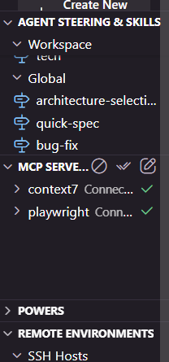

# Kiro log

Evidence for the write-up. Add an entry every session. Save screenshots in docs/screenshots/.

Write-up sections to cover: surfaces (IDE/CLI/Web/Crew), custom agents, hooks, specs vs vibe coding,
steering, MCP, property-based testing, powers.

## 2026-11-27
- Surface: Kiro IDE
- Feature used: steering (product, tech, structure, event-contract, horror-tone, performance)
- What happened: added six workspace steering files. Four load always; horror-tone and
  performance load only for matching files (fileMatch) to save context. event-contract.md pulls
  in src/input/events.ts and src/config/spells.ts via `#[[file:]]`. Kiro only detected the
  steering files and MCP servers after a window reload.
- Screenshot: 
- What it changed / lesson: referencing the contract files from steering should stop Kiro
  inventing event types; verify in Phase 1.
